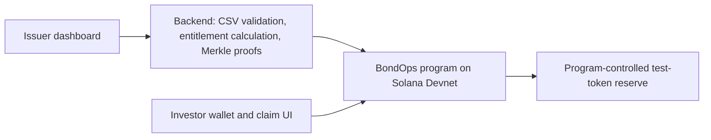

# BondOps — Corporate Actions for Tokenized Bonds

> A Solana-based prototype for preparing, announcing, and distributing coupon and redemption payments to tokenized bond holders.

Built for the **Superteam Kazakhstan × KASE: Corporate Actions on Blockchain** side track.

**Live demo:** [Open BondOps on Vercel](https://solanaproject-pink.vercel.app/)

---

## Problem and Solution

Corporate actions such as coupon payments and bond redemption require issuers and administrators to identify eligible holders, calculate entitlements, distribute funds, and reconcile completed payments. When these steps are handled across spreadsheets and separate payment workflows, it can be difficult to give every participant a clear, auditable status.

**BondOps** models this workflow as a verifiable on-chain event. An administrator imports a holder snapshot, reviews the calculated entitlements, funds a payment reserve, and publishes the action. Eligible investors connect a wallet and claim their allocation. The prototype is designed for Solana Devnet and uses test assets only.

---

## Corporate Action Workflow

1. **Create an action** — choose a demo bond and select coupon or redemption.
2. **Import a holder snapshot** — upload a CSV of wallet addresses and eligible balances for the record date.
3. **Review entitlements** — inspect the per-holder payout and total amount before approval.
4. **Fund and publish** — deposit demo payment tokens and publish the action parameters on Solana.
5. **Claim and reconcile** — each eligible wallet claims once; the dashboard shows the transaction and action status.

For the prototype, the holder snapshot is supplied manually. It is not connected to KASE, a registrar, or a production investor registry.

---

## Why Solana

- **Verifiable execution** — action parameters and claim transactions can be checked on-chain.
- **Program-controlled payouts** — a Solana program can release demo tokens from an action reserve when a claim is valid.
- **Composable token infrastructure** — token transfers can be performed through Solana's Token Program.
- **Low-friction prototype** — the complete flow can be demonstrated on Devnet without handling real securities or money.

---

## Prototype Scope

- Demo tokenized bond and test payout token
- Coupon action from an imported holder snapshot
- Simplified maturity/redemption action
- Per-investor claim with duplicate-claim protection
- Action status and transaction references
- Issuer preview before an action is published

This is a hackathon prototype, not a live securities platform. It does not issue or trade securities, custody real assets, calculate legally binding entitlements, or integrate with KASE systems.

---

## Architecture

The backend prepares a snapshot and claim proofs. The on-chain program stores the action parameters and verifies claims before transferring test tokens from a program-controlled reserve. The on-chain proof verifies that a claim matches the published snapshot; it does not independently verify that the original snapshot was accurate.

---

## Planned Tech Stack

| Layer | Technology |
| --- | --- |
| On-chain program | Rust · Anchor |
| Blockchain | Solana Devnet |
| Token transfers | Solana Token Program |
| Backend and proof generation | TypeScript · Node.js |
| Frontend | React · Next.js · Solana Wallet Adapter |
| Snapshot storage | PostgreSQL or a local development database |

This describes the proposed prototype architecture. Components will be marked as implemented once they are present in the repository.

---

## Development Status

**Current status:** static, interactive product demo prepared for Vercel. The demo uses sample data only; it does not connect a wallet, call a Solana program, or transfer tokens. There is no smart contract or live investor registry in this repository yet.

### Run locally

The frontend is plain HTML, CSS, and JavaScript, so it has no npm dependencies or build step. Open `public/index.html` in a browser, or serve the `public` folder with any static web server.

### Deploy to Vercel

This repository is configured as a static site. Import the GitHub repository in Vercel and use **Other** as the framework preset, leave the build command empty, and set the output directory to `public`. The root-level `vercel.json` sets the output directory for the project.

Vercel does not deploy the Solana program from this repository; the current site is a static frontend demo.

### Roadmap

- [ ] Implement coupon action and one-time investor claims on Devnet
- [ ] Add CSV import, validation, and payout preview
- [x] Add static issuer and investor demo views
- [x] Prepare a Vercel static-site configuration
- [ ] Connect investor claims to a Solana program
- [ ] Add an authoritative holder snapshot source
- [ ] Demonstrate real Devnet transactions

---

## Track

**Superteam Kazakhstan × KASE — Corporate Actions on Blockchain**

BondOps is an independent prototype prepared for the track. It is not affiliated with, endorsed by, or integrated with KASE.
